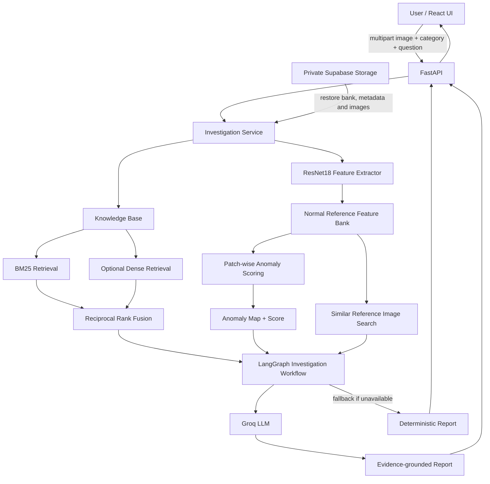

# Visual Manufacturing Defect Investigation Copilot

An evidence-grounded computer-vision investigation prototype for manufacturing quality inspection. The system compares an uploaded product image with a bank of normal reference images, produces a spatial anomaly map, retrieves relevant technical-document passages, and assembles an investigation report with source citations.

> **Project status:** Research prototype. This system is intended to support human investigation, not to make autonomous quality-release decisions. Its anomaly score is not a calibrated defect probability, and visual similarity does not establish a common root cause.

<p align="center">
  <strong>React + TypeScript</strong> · <strong>FastAPI</strong> · <strong>PyTorch / ResNet18</strong> · <strong>Hybrid Retrieval</strong> · <strong>LangGraph</strong> · <strong>Groq</strong> · <strong>Supabase Storage</strong>
</p>

## Contents

- [What the system does](#what-the-system-does)
- [System architecture](#system-architecture)
- [Investigation pipeline](#investigation-pipeline)
- [Computer-vision methodology](#computer-vision-methodology)
- [Knowledge retrieval and evidence handling](#knowledge-retrieval-and-evidence-handling)
- [Report generation](#report-generation)
- [Technology stack](#technology-stack)
- [Repository structure](#repository-structure)
- [Getting started](#getting-started)
- [Configuration](#configuration)
- [Reference-bank preparation](#reference-bank-preparation)
- [API reference](#api-reference)
- [Deployment](#deployment)
- [Memory and runtime considerations](#memory-and-runtime-considerations)
- [Security and operational notes](#security-and-operational-notes)
- [Limitations and future work](#limitations-and-future-work)

## What the system does

The Copilot combines visual anomaly detection with retrieval-augmented technical investigation.

Given an inspection image and product category, it:

1. Extracts spatial visual features using a pretrained ResNet18 backbone.
2. Compares each query feature location with normal reference patches.
3. Produces an anomaly score and spatial anomaly map.
4. Finds visually similar reference images as supporting context.
5. Searches technical knowledge using BM25 and, when enabled and installed, dense semantic retrieval.
6. Fuses lexical and semantic rankings using Reciprocal Rank Fusion (RRF).
7. Passes visual observations and retrieved evidence through a LangGraph workflow.
8. Generates a cited Markdown investigation report with Groq, or a deterministic fallback report when the LLM is unavailable.

The interface accepts PNG/JPEG inspection images, a category (the deployed reference bank is currently configured for `bottle`), and an optional investigation question.

## System architecture



### Runtime components

- **Frontend:** React, TypeScript and Vite. Builds a multipart request and renders the report, anomaly score, and retrieved evidence.
- **API:** FastAPI handles image investigation, knowledge ingestion, health checks and optional database connectivity checks.
- **Vision service:** A lazily initialized ResNet18 feature extractor and reference-bank implementation.
- **Retrieval service:** Persistent local knowledge chunks, BM25 index and optional dense embeddings/FAISS.
- **Workflow:** A sequential LangGraph graph for retrieval, evidence labeling and report generation.
- **Storage:** A private Supabase Storage bucket holds the reference bank, manifest, metadata and reference images. The backend restores these assets to its local runtime cache.
- **Optional database connectivity:** SQLAlchemy/psycopg can connect to Neon/PostgreSQL. The current integration is a connectivity check; it does not implement application tables or migrations.

## Investigation pipeline

### 1. Request intake

The frontend sends a `multipart/form-data` request to `POST /investigate` containing:

- `file`: PNG or JPEG image.
- `category`: reference-bank category.
- `query`: optional natural-language investigation question.

The API validates the media type and filename extension, writes the upload to a temporary file, invokes the investigation service, and removes the temporary file after processing.

### 2. Reference asset availability

The backend uses the configured local artifact cache when available. In the deployed configuration, Supabase Storage is used to restore:

- `reference_bank.npz`
- `reference_metadata.json`
- The category's normal reference images

The bank manifest contains a SHA-256 checksum and size metadata. When a bank must be downloaded, the backend reconstructs it from storage chunks and verifies the checksum before replacing the local cache file. Reference images are downloaded when missing.

### 3. Visual analysis

The query image is transformed to RGB, resized to the configured square input size (default: 256 × 256), normalized with ImageNet channel statistics, and passed through the ResNet18 feature extractor.

### 4. Similar visual cases

The mean-pooled spatial feature vector is L2-normalized and compared with normalized embeddings from the normal reference images using cosine similarity. The top-`k` results are returned as visual retrieval hints.

### 5. Technical evidence retrieval

The investigation question is searched against ingested knowledge. If the user does not provide a question, the workflow creates a category- and anomaly-context query. BM25 is always available; dense retrieval is optional.

### 6. Report assembly

LangGraph executes three sequential nodes:

1. `retrieve_context` — retrieve relevant technical passages.
2. `validate_evidence` — assign report citation labels such as `[S1]`, `[S2]`.
3. `generate_report` — call Groq with the visual observations, similar cases and cited passages, or produce a deterministic fallback report.

The LLM prompt explicitly instructs the model not to invent root causes, machine readings, procedures, standards or maintenance actions.

## Computer-vision methodology

### Feature extraction

The vision module uses the pretrained torchvision ResNet18 model and retains the early convolutional stages through `layer2`. It is used as a feature extractor, not as a trained defect classifier.

For an input image, the backbone produces a spatial feature tensor:

[
F in mathbb{R}^{H \times W \times C}
]

Each spatial location is treated as a feature descriptor. The normal reference bank contains descriptors extracted from the normal training images.

### Nearest-reference patch distance

For each query descriptor (q_i), the system finds its nearest reference descriptor (r_j) using squared Euclidean distance:

[
d(q_i, r_j)^2 = \|q_i\|_2^2 + \|r_j\|_2^2 - 2q_i^T r_j
]

The anomaly distance at query location (i) is:

[
a_i = \min_j \|q_i-r_j\|_2
]

The nearest-neighbour comparison is processed in batches to avoid constructing the complete query-by-reference distance matrix at once. The resulting distances are reshaped into a spatial anomaly map.

### Anomaly score and visualization

- **Image-level score:** the 95th percentile of the spatial patch distances.
- **Heatmap:** a visualization normalized using the 2nd and 98th percentiles of the query's raw patch distances, then resized to the original image dimensions.
- **Anomaly map:** the raw spatial distances resized to the original image dimensions.

The heatmap normalization is for visualization only. The image-level score is not calibrated as a probability and should not be interpreted as a pass/fail threshold without validation on representative production data.

### Similar-image retrieval

For each image, the feature map is mean-pooled over its spatial dimensions and L2-normalized. Query and reference embeddings are compared with a dot product (cosine similarity for normalized vectors).

The current implementation caches reference-image embeddings in process memory after they are first computed. These results indicate visual similarity only; they are not defect labels or causal evidence.

## Knowledge retrieval and evidence handling

### Supported knowledge sources

The document ingestion endpoint accepts:

- Plain text (`.txt`)
- Markdown (`.md`)
- PDF (`.pdf`)
- Word documents (`.docx`)

PDF extraction uses pypdf; DOCX extraction uses python-docx.

### Chunking

Extracted text is whitespace-normalized and divided into overlapping character windows. Defaults are:

- Chunk size: 900 characters
- Overlap: 140 characters

Each chunk retains source information, title, chunk number and a source hash.

### BM25 lexical retrieval

The knowledge base tokenizes text into lowercase alphanumeric terms and builds a BM25 index over document chunks. BM25 is useful for exact terminology such as component names, failure codes, inspection terms and process vocabulary.

### Optional dense retrieval

When the semantic extra is installed and semantic retrieval is enabled:

- SentenceTransformers encodes document chunks using the configured embedding model.
- Embeddings are normalized.
- FAISS inner-product search is used when FAISS is installed.
- If FAISS is unavailable, exact cosine search is performed with NumPy.

Dense retrieval is optional. If it cannot initialize, lexical BM25 retrieval remains available.

### Reciprocal Rank Fusion

BM25 and dense search scores are not directly comparable. The system combines their ranked lists with Reciprocal Rank Fusion:

[
RRF(d) = \sum_{r \in \text{retrievers}} \frac{1}{k + rank_r(d)}
]

The default RRF constant is (k=60). The highest fused-ranking documents are passed to the report workflow. Returned evidence includes source, title, passage text and available retrieval scores.

## Report generation

When `GROQ_API_KEY` is configured, the workflow calls the configured Groq model (default: `llama-3.3-70b-versatile`) with:

- Category and uploaded image name
- Anomaly score and feature-map shape
- A plain-language interpretation of what the anomaly score measures
- Similar visual reference cases
- Retrieved evidence passages and citation identifiers
- Retrieval scores where available

The prompt requires the model to distinguish computer-vision observations from documentary evidence and cite claims based on retrieved passages.

If the API key is missing, the Groq request fails, or the response is empty, the workflow returns a deterministic report. The API response identifies the report provider and includes an LLM error field when fallback was used.

## Technology stack

| Layer | Technologies |
|---|---|
| Frontend | React, TypeScript, Vite |
| Backend API | Python, FastAPI, Uvicorn, Pydantic Settings |
| Computer vision | PyTorch, torchvision, ResNet18, OpenCV, Pillow, NumPy |
| Anomaly method | Pretrained spatial features, nearest-reference patch distance |
| Retrieval | rank-bm25, SentenceTransformers (optional), FAISS CPU (optional), NumPy |
| Workflow orchestration | LangGraph |
| LLM | Groq API |
| Document parsing | pypdf, python-docx |
| Storage | Supabase Storage |
| Optional database connectivity | Neon/PostgreSQL, SQLAlchemy, psycopg |
| Deployment | Docker, Render |

## Repository structure

```text
.
├── app/
│   ├── api/
│   │   └── main.py                 # FastAPI routes and startup asset restoration
│   ├── retrieval/
│   │   └── knowledge.py            # Document ingestion, BM25, dense retrieval, RRF
│   ├── storage/
│   │   └── supabase_storage.py     # Reference asset restoration and verification
│   ├── vision/
│   │   └── anomaly.py               # ResNet18 features and reference-bank analysis
│   ├── workflow/
│   │   └── investigation.py         # LangGraph evidence and report workflow
│   ├── cli.py                       # Command-line entry point (see project status)
│   ├── config.py                    # Environment-backed settings
│   ├── database.py                  # Lazy PostgreSQL connection helper
│   └── services.py                  # Component lifecycle and investigation orchestration
├── artifacts/
│   ├── knowledge_chunks.json        # Persisted knowledge chunks
│   └── knowledge_embeddings.npy     # Optional dense knowledge vectors
├── frontend/
│   ├── src/
│   │   ├── App.tsx                  # Investigation UI
│   │   ├── main.tsx                 # React entry point
│   │   └── style.css                # UI styling
│   ├── package.json
│   └── vite.config.ts
├── .env.example
├── Dockerfile
├── docker-compose.yml
├── pyproject.toml
└── render.yaml
```

Generated reference-bank files and runtime outputs are stored under the configured artifact directory. They are not all tracked in Git.

## Getting started

### Prerequisites

- Python 3.10 or newer (the deployment Docker image uses Python 3.11).
- Node.js and npm.
- Git.
- A Groq API key for LLM-generated reports (optional; deterministic fallback is available).
- Supabase project credentials if you want the backend to restore the deployed reference assets.
- A local reference bank if you are not using Supabase Storage.

### 1. Clone the repository

```bash
git clone https://github.com/kiruba11k/Visual-Defect-Copilot.git
cd Visual-Defect-Copilot
```

### 2. Create a Python environment

**Windows PowerShell**

```powershell
py -3.11 -m venv .venv
.\.venv\Scripts\Activate.ps1
python -m pip install --upgrade pip
pip install -e .
```

**macOS / Linux**

```bash
python3 -m venv .venv
source .venv/bin/activate
python -m pip install --upgrade pip
pip install -e .
```

Install optional development and semantic-retrieval dependencies only if needed:

```bash
pip install -e ".[dev,semantic,faiss]"
```

> The semantic extra installs SentenceTransformers, which brings additional model and memory requirements. For a memory-constrained deployment, keep semantic retrieval disabled unless the instance has been sized and tested for it.

### 3. Configure backend environment

Copy the example file:

**Windows PowerShell**
```powershell
Copy-Item .env.example .env
```

**macOS / Linux**
```bash
cp .env.example .env
```

Add the required values to `.env`. Do not commit this file.

Example:

```dotenv
GROQ_API_KEY=your_groq_api_key
GROQ_MODEL=llama-3.3-70b-versatile
DATABASE_URL=

SUPABASE_URL=https://YOUR_PROJECT_REF.supabase.co
SUPABASE_SERVICE_ROLE_KEY=your_server_side_service_role_key
SUPABASE_STORAGE_BUCKET=defect-reference-data
SUPABASE_REFERENCE_CATEGORY=bottle

DEVICE=cpu
IMAGE_SIZE=256
TOP_K=5
RETRIEVAL_TOP_K=5
ENABLE_SEMANTIC_RAG=false
CORS_ORIGINS=http://localhost:5173
```

Only set Supabase variables when the matching private bucket objects have been uploaded. The service-role key must remain on the backend and must never be placed in a `VITE_*` variable.

### 4. Start the backend

```bash
uvicorn app.api.main:app --reload --host 0.0.0.0 --port 8000
```

API documentation is available at:

- Swagger UI: `http://localhost:8000/docs`
- OpenAPI schema: `http://localhost:8000/openapi.json`

### 5. Start the frontend

Open a second terminal:

```bash
cd frontend
npm install
```

Create `frontend/.env`:

```dotenv
VITE_API_BASE_URL=http://localhost:8000
```

Then run:

```bash
npm run dev
```

Open the Vite URL printed in the terminal (normally `http://localhost:5173`).

## Configuration

Settings are loaded through Pydantic Settings from environment variables and the backend `.env` file. Environment variable names are case-insensitive.

| Variable | Purpose | Default / example |
|---|---|---|
| `GROQ_API_KEY` | Groq authentication; optional for deterministic fallback | unset |
| `GROQ_MODEL` | Report-generation model | `llama-3.3-70b-versatile` |
| `DATABASE_URL` | Optional Neon/PostgreSQL connection string | unset |
| `SUPABASE_URL` | Supabase project URL | unset |
| `SUPABASE_SERVICE_ROLE_KEY` | Backend-only Storage credential | unset |
| `SUPABASE_STORAGE_BUCKET` | Private reference asset bucket | `defect-reference-data` |
| `SUPABASE_REFERENCE_CATEGORY` | Category restored from Storage | `bottle` |
| `DEVICE` | PyTorch device selection | `auto`; Render sets `cpu` |
| `IMAGE_SIZE` | Square image input size | `256` |
| `TOP_K` | Number of similar visual cases | `5` |
| `RETRIEVAL_TOP_K` | Number of knowledge passages | `5` |
| `EMBEDDING_MODEL` | SentenceTransformers model name | `sentence-transformers/all-MiniLM-L6-v2` |
| `ENABLE_SEMANTIC_RAG` | Enable dense semantic retrieval | `true` in application defaults; `false` in Render blueprint |
| `CORS_ORIGINS` | Comma-separated allowed frontend origins | `http://localhost:5173` |
| `GROQ_TIMEOUT_SECONDS` | Groq request timeout | `45` |
| `ARTIFACT_DIR` | Runtime artifact directory | `artifacts` |
| `DATA_DIR` | Input data directory | `data` |

The frontend reads `VITE_API_BASE_URL` from its build environment. Set that exact variable to the backend URL when building the Vite application.

## Reference-bank preparation

The anomaly detector requires a bank of normal reference images. The indexing implementation expects an MVTec-style directory:

```text
data/
└── mvtec/
    └── bottle/
        └── train/
            └── good/
                ├── image_001.png
                ├── image_002.png
                └── ...
```

The reference bank is created by extracting a feature map from each normal image and concatenating its spatial descriptors. The generated local artifacts are:

- `artifacts/reference_bank.npz` — concatenated normal patch features.
- `artifacts/reference_metadata.json` — source image paths and category.

For the hosted deployment, the configured category's bank and reference images are stored in the private Supabase bucket. The current deployed configuration targets the `bottle` category. Adding another category requires preparing and uploading its own bank, manifest, metadata and image objects, and updating the backend category configuration.

The upload utility used during the initial data setup is not included in the current repository tree. Use the project's separately maintained upload procedure or add a versioned ingestion utility before attempting to reproduce the Supabase upload from a fresh clone.

## API reference

### `GET /health`

Basic process health check.

Example response:

```json
{"status": "ok"}
```

### `POST /investigate`

Runs the complete visual and documentary investigation.

**Content type:** `multipart/form-data`

| Field | Type | Required | Description |
|---|---|---:|---|
| `file` | File | Yes | PNG or JPEG inspection image |
| `category` | String | Yes | Category matching the configured reference bank |
| `query` | String | No | Investigation question or symptom description |

The response includes:

- `category`
- `anomaly_score`
- `heatmap_path`
- `similar_cases` — similarity score and reference image path
- `retrieved_documents` — source passages and retrieval metadata
- `report` — generated or deterministic Markdown report
- `llm_provider` and `llm_error`
- `knowledge_status`
- `warning` — prototype limitations

Example request:

```bash
curl -X POST "http://localhost:8000/investigate" \
  -F "category=bottle" \
  -F "query=What inspection checks are relevant to surface cracks?" \
  -F "file=@sample.png"
```

### `GET /artifacts/heatmap`

Returns the most recently written heatmap PNG. This is a shared last-result artifact on the running instance, not a per-request immutable result.

### `POST /knowledge/ingest`

Uploads and ingests one TXT, Markdown, PDF or DOCX file.

- Maximum accepted document upload: 15 MB.
- Text is extracted, chunked, persisted under the artifact directory and added to the BM25 corpus.
- Adding documents invalidates the existing dense index.

### `POST /knowledge/index`

Builds or rebuilds the dense semantic index. Requires the semantic dependencies and access to the configured embedding model. This operation is not required for BM25-only search.

### `GET /knowledge/status`

Returns document count, BM25 readiness, semantic index status and configured embedding model.

### `POST /index/{category}`

Builds a normal reference bank from `data/mvtec/{category}/train/good`. This is an indexing operation for local dataset preparation; it is not part of ordinary hosted image investigation.

### `GET /db/health`

Checks connectivity to the configured PostgreSQL database using `SELECT 1`. Returns HTTP 503 when `DATABASE_URL` is missing or the connection fails. No application schema or migrations are currently defined.

## Deployment

### Render

The repository contains a Render Blueprint in `render.yaml` with:

- A Docker-based FastAPI web service.
- A static React/Vite frontend service.
- `/health` as the backend health-check endpoint.
- Environment-variable placeholders for Groq, Neon and Supabase credentials.
- CPU inference and semantic retrieval disabled in the backend blueprint.

Deployment outline:

1. Push the repository to GitHub.
2. Create a Render Blueprint from `render.yaml`.
3. Add the backend secrets in the Render API service environment.
4. Set the frontend build variable `VITE_API_BASE_URL` to the deployed API URL.
5. Confirm the API health endpoint returns HTTP 200.
6. Test a real image investigation and inspect service logs and memory metrics.

**Important configuration check:** The current `frontend/src/App.tsx` reads `VITE_API_BASE_URL`, while the current `render.yaml` frontend environment entry is named `VITE_API_URL`. These names do not match. Set `VITE_API_BASE_URL` in Render's frontend build environment (or align the source and Blueprint) before relying on the deployed frontend.

### Supabase Storage

The reference-data bucket is private. The backend uses the service-role credential to download the manifest, reference-bank chunks, metadata and image files. The bank is checked against the manifest SHA-256 before it is accepted.

Do not expose the service-role key in frontend variables, browser code, public logs or committed files. Supabase is currently used for reference assets; it is not a general persistence layer for all runtime uploads or generated reports.

### Neon / PostgreSQL

The project includes a lazy SQLAlchemy connection helper and `/db/health` endpoint. Use a PostgreSQL connection URL; the helper converts a standard `postgresql://` URL to the psycopg 3 SQLAlchemy dialect. Application tables, migrations and persistence workflows are not implemented yet.

## Memory and runtime considerations

The vision pipeline loads PyTorch/torchvision and the reference feature bank into process memory. This can be significant on small instances.

Current safeguards and optimizations include:

- Lazy initialization of the feature extractor, reference bank, knowledge base and workflow.
- A single Uvicorn worker in the Docker command.
- A process-level inference lock that rejects overlapping investigations rather than running multiple heavy inference requests simultaneously.
- Batched query-to-reference distance calculations.
- Reuse of the reference feature array without making a full-size `float32` copy during each inspection.
- Cached reference feature norms.
- Cached pooled embeddings for reference images after first use.
- CPU thread limits in the Docker image.
- Semantic retrieval disabled in the Render Blueprint to avoid loading the optional embedding model on the constrained instance.

These measures reduce avoidable allocations and repeated work; they do not guarantee that every deployment size can run the model. Benchmark cold starts, first inference, repeated inference and concurrent requests on the target plan. Monitor peak resident memory, not only idle memory.

The reference bank is currently stored as a compressed NPZ file. Loading it expands the array into memory; NumPy memory mapping is not available for arrays inside a compressed NPZ archive. A future large-bank deployment may benefit from a standalone `.npy` representation with memory mapping or a dedicated inference service.

Render's free web services have constrained resources and ephemeral local filesystems. Supabase restores the reference assets, but knowledge uploads and other generated runtime files need a separate durable-storage design if they must survive instance replacement.

## Security and operational notes

- Keep all API keys and database credentials in backend environment variables.
- Never put `SUPABASE_SERVICE_ROLE_KEY`, `GROQ_API_KEY` or `DATABASE_URL` in frontend build variables.
- Keep `.env` out of version control.
- Restrict CORS to known frontend origins in deployed environments.
- Treat uploaded images and documents as untrusted input.
- The current investigation route validates image content type and extension, but does not yet enforce a maximum image upload size or comprehensive decoded-image dimension limits. Add request-size and image-decompression safeguards before exposing the endpoint to untrusted public traffic.
- The heatmap endpoint returns a shared latest-result file. For multi-user production use, store artifacts per request and authorize access to them.
- Add authentication, rate limiting, structured audit logging and request-level observability before production deployment.

## Limitations and future work

### Current limitations

- The vision backbone is pretrained ResNet18 layer2 features; it is not fine-tuned on a production defect dataset.
- The nearest-reference distance is an anomaly signal, not a defect classifier or calibrated probability.
- The reference bank and hosted category are currently configured around the `bottle` category.
- Similar-image retrieval returns visual neighbors, not verified historical incidents.
- RAG quality depends on the relevance, quality and coverage of ingested technical documents.
- Dense retrieval is optional and disabled in the current Render Blueprint.
- Groq report generation depends on an external API; a deterministic fallback is provided.
- Neon integration currently checks connectivity only.
- Runtime document uploads and generated artifacts are not backed by a general persistent data store.
- The current free-tier deployment must be load- and memory-tested before it can be considered reliable for real workloads.

### Potential next steps

- Evaluate image-level and pixel-level AUROC on a held-out dataset with ground-truth masks.
- Calibrate category-specific thresholds using validation data and document false-positive/false-negative trade-offs.
- Add request-level artifact storage and immutable investigation history.
- Add user authentication, access control, rate limits and upload-size validation.
- Add observability for latency, peak memory, model initialization, retrieval quality and LLM failures.
- Move inference to a memory-appropriate worker or optimize the reference-bank storage format for larger datasets.
- Add automated tests for feature extraction, anomaly-map generation, retrieval ranking, evidence citations and API validation.
- Implement database schema and migrations if investigation history or user data is required.

## License

No license file is currently included. All rights and reuse permissions should be treated as unspecified until a license is added.

---

**Built as an applied AI engineering prototype exploring computer vision, retrieval-augmented generation, workflow orchestration and deployable inference services.**
